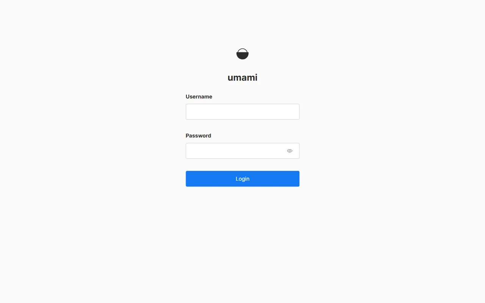

<!-- readme-padrao -->
# Métricas dos sites (Umami)

> Umami autogerenciado com as métricas de visita dos sites da Rangel Tech.

## O que é
Umami autogerenciado com as métricas de visita dos sites da Rangel Tech.

Estado: **no ar**.

## Onde está no ar
- https://metricas.rangeltech.net

## Onde faz o deploy
Este repositório **só publica** o artefato (release com imagem e manifesto); **quem implanta é o `vps_rt_infra`**.

- Serviço `umami`: `gh workflow run deploy.yml --repo RangelTech/vps_rt_infra -f service=umami` (só validar: `-f dry_run=true`; voltar versão: `-f version=<tag-antiga>`)
- Serviço `umami-db`: `gh workflow run deploy.yml --repo RangelTech/vps_rt_infra -f service=umami-db` (só validar: `-f dry_run=true`; voltar versão: `-f version=<tag-antiga>`)

Os `.env` desses serviços são gerados do Infisical no momento do deploy (spec 57, seção 0A).

## Como funciona por dentro
Resumo acima; os detalhes estão nas notas técnicas (README anterior) abaixo e na spec 57.

## Segredos
Nenhum valor de segredo fica neste repositório. Os segredos dos serviços ficam no Infisical (mapa em `vps_rt_infra/scripts/infisical/mapa_envs.json`) e chegam à VPS gerados no deploy.

## Rodar e testar localmente
Ver as notas técnicas abaixo (cada repositório tem o seu jeito); os testes de QA em produção são por cliques reais, com evidência em `new_ragente/qa/evidencias`.

## Links
- Repositório: https://github.com/RangelTech/ai_metricas
- Painel único: https://painel.rangeltech.net
- Spec de organização geral: `new_ragente/specs/57_ORGANIZACAO_GERAL_PRODUTOS_E_PAINEL.md`

## Notas técnicas (README anterior)

# ai_metricas

Empacotamento do **Umami** (métricas dos sites, sem cookie) e do **Postgres** dele para o fluxo de release do
[`vps_rt_infra`](https://github.com/RangelTech/vps_rt_infra). Este repositório não tem código de aplicação: só fixa por
digest as imagens oficiais (`images.env`), gera os artefatos e os manifestos. O deploy (stack `umami`, DNS
`metricas.rangeltech.net`, segredos gerados na própria VPS) é inteiramente do `vps_rt_infra`.

Fluxo: workflow **Release** (informe a versão) → `release-intake` do `vps_rt_infra` grava os locks `umami` e `umami-db`
→ workflow **Deploy** (primeiro `umami-db`, depois `umami`).

Sem segredo neste repositório. A senha do administrador vive no cofre do dono; aqui só existe o hash dela.
